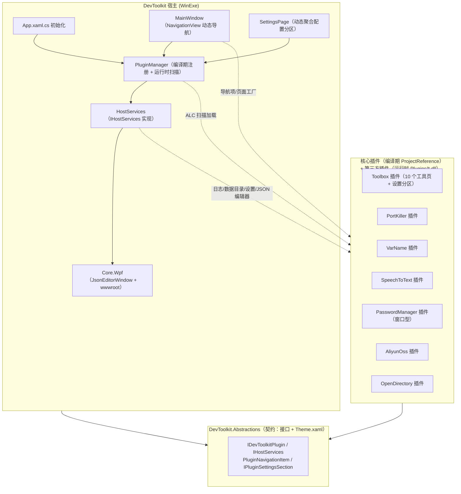

## 产品概述

将 DevToolkit 从单体 WPF 应用重构为插件宿主架构：DevToolkit 仅保留导航框架、日志、设置存储、数据目录、WebView2 窗口等宿主能力，所有功能（工具箱、端口占用、变量名、语音转文字、密码管理器、阿里云OSS、打开目录）均以插件形式提供。插件可通过宿主接口获取能力并完成初始化；宿主支持核心插件编译期注册，同时支持运行时扫描第三方插件 DLL。

## 核心功能

- 插件契约：定义插件入口（初始化、注册导航项、注册配置表单）与宿主能力接口（日志、插件专属数据目录、按插件命名空间读写 JSON 设置、打开 JSON 编辑器等窗口、WebView2 路径）
- 插件多页面：单个插件可注册多个导航项/页面（如 Toolbox 插件注册 10 个工具页面）
- 插件加载：内置插件编译期注册 + 启动时扫描 `Plugins` 目录 DLL（AssemblyLoadContext）反射加载第三方插件
- 宿主设置页动态聚合各插件的配置表单，由宿主统一管理
- 导航界面由插件驱动：左侧导航项、图标、页面工厂均来自插件注册，不再硬编码
- 新增接入：密码管理器、阿里云OSS、打开目录以插件形式接入导航界面
- 兼容性：现有 FlowLauncher.Plugin.* 插件项目与单元测试保持可编译、可运行

## 非目标

- 不改变现有 UI 视觉风格与交互
- 不实现插件热卸载（本次仅加载；文档约定重启生效）

## 技术栈

- .NET 9 / WPF：`net9.0-windows7.0` + `UseWPF`（宿主、契约、全部插件统一）
- iNKORE.UI.WPF.Modern：现有导航与控件体系（保持不变）
- CommunityToolkit.Mvvm：现有 ViewModel 模式（保持不变）
- Serilog + Microsoft.Extensions.Logging：统一日志（宿主注入插件）
- System.Runtime.Loader.AssemblyLoadContext：第三方插件动态加载
- WebView2 + wwwroot：宿主 JSON 编辑器能力（沿用现有 DevToolkit.Core.Wpf）

## 实现思路

新增契约项目 `DevToolkit.Abstractions`（net9.0-windows + UseWPF）承载插件接口与宿主能力接口；宿主保留 UI 框架与共享服务，导航/设置页改为插件驱动；各 Core 模块升级为插件（迁移宿主内页面/VM 进入模块，通过 `IHostServices` 注入替代静态 `AppServices` 依赖）；插件加载采用"编译期注册表 + 运行时 ALC 扫描"双通道；`AppServices` 重构为实例化的 `HostServices`。FlowLauncher.Plugin.* 项目 target 已是 net9.0-windows + UseWPF，Core 模块升级不影响其编译。

### 系统架构



### 模块职责

- **DevToolkit.Abstractions（[NEW]）**：插件契约与宿主能力接口；`Resources/Theme.xaml` 承载 PageTitle/PageSubtitle/SectionTitle/PageHint/Card 共享样式（自宿主 App.xaml 迁入），作为"宿主主题契约"，插件页面通过 StaticResource 引用（查找链回退到宿主 Application.Resources）。
- **DevToolkit（宿主）**：初始化 HostServices 与 PluginManager；MainWindow 遍历插件导航项构建 NavigationView；SettingsPage 遍历插件设置分区动态渲染；保留 AboutPage 并展示插件列表。
- **各 Core 模块（升级为插件）**：实现 `IDevToolkitPlugin`，页面/VM 迁入模块，`AppServices.*` 依赖全部改为 `IHostServices` 注入；业务 Services 与 Settings 公共 API 保持不变（FlowLauncher 插件与 tests 兼容）。
- **DevToolkit.Core.Wpf**：仅保留 JsonEditorWindow + wwwroot（宿主 JSON 编辑器能力）；ManagerWindow 与三个对话框迁往 PasswordManager。

### 性能与可靠性

- 插件扫描：启动时一次性扫描 + 类型缓存；页面工厂沿用现有"按需创建 + 缓存"模式（MainWindow 现有 `_toolViews` 模式），避免重复实例化。
- 容错：单个插件初始化/加载失败仅记日志并跳过，不阻断宿主启动；动态插件 ALC 按插件目录隔离依赖解析。
- 设置兼容：`LoadJsonSettings` 读取时兼容旧路径（`DataRoot/<fileName>`），避免升级丢失用户配置。
- 动态插件 WPF 约束（文档约定）：插件页面依赖宿主 Application.Resources 样式；插件内不跨程序集合并 ResourceDictionary；iNKORE 控件需与宿主同版本 PackageReference。

## 目录结构

```
src/Core/DevToolkit.Abstractions/              # [NEW] 契约项目（net9.0-windows + UseWPF）
├── IDevToolkitPlugin.cs                       # 插件入口接口（Initialize/导航项/设置分区/NavigationChanged）
├── IHostServices.cs                           # 宿主能力接口（日志/数据目录/设置/JSON 编辑器/路径）
├── IPluginSettingsSection.cs                  # 配置表单分区接口（标题+说明+视图工厂）
├── PluginNavigationItem.cs                    # 导航项 record（Tag/显示名/图标/页面工厂/可见性委托）
├── Resources/Theme.xaml                       # [MOVED] 共享样式（自 DevToolkit/App.xaml 迁入）
└── DevToolkit.Abstractions.csproj

src/DevToolkit/                                # 宿主改造
├── App.xaml                                   # [MODIFY] 合并 Theme.xaml；移除 StartupUri
├── App.xaml.cs                                # [MODIFY] 初始化 HostServices/PluginManager，代码启动 MainWindow
├── MainWindow.xaml                            # [MODIFY] 删除 XAML 内硬编码菜单项
├── MainWindow.xaml.cs                         # [MODIFY] 删除 ToolCatalog/CreateToolView/GetGlyph；改为插件驱动导航
├── Services/AppServices.cs                    # [MODIFY] 收敛为基础设施（DataRoot/日志初始化），移除各模块设置硬编码
├── Services/HostServices.cs                   # [NEW] 实现 IHostServices
├── Services/PluginManager.cs                  # [NEW] 编译期注册 + 运行时扫描/初始化/导航聚合
├── Services/PluginLoadContext.cs              # [NEW] AssemblyLoadContext 动态加载第三方插件
├── Views/SettingsPage.xaml/.cs                # [MODIFY] 动态聚合 IPluginSettingsSection
├── Views/AboutPage.xaml/.cs                   # [MODIFY] 展示已加载插件列表
└── 删除：Views/Tools/*、PortKillerPage、VarNamePage、SpeechToTextPage、Controls/ResultRowsView、ViewModels/*（迁往插件）

src/Core/DevToolkit.Core.Wpf/                  # 瘦身
├── JsonEditorWindow.xaml/.cs                  # 保留（宿主能力）
├── wwwroot/                                   # 保留
├── 删除：ManagerWindow/EditPasswordDialog/ImportDialog/ExportDialog（迁往 PasswordManager）
└── DevToolkit.Core.Wpf.csproj                 # [MODIFY] 移除对 PasswordManager 的 ProjectReference

src/Core/DevToolkit.Toolbox/                   # [MODIFY] → 插件
├── DevToolkitPlugin.cs                        # [NEW] 入口：10 个工具导航项（多页面）+ 工具开关设置分区
├── Views/Tools/*.xaml/.cs                     # [MOVED] 10 个工具页面（自宿主 Views/Tools）
├── Views/Controls/ResultRowsView.xaml/.cs     # [MOVED]（依赖 ToolRow，随 Toolbox）
├── Services/ToolRow.cs                        # 保留（已有）
└── DevToolkit.Toolbox.csproj                  # [MODIFY] net9.0-windows7.0+UseWPF，引用 Abstractions

src/Core/DevToolkit.PortKiller/                # [MODIFY] → 插件
├── DevToolkitPlugin.cs                        # [NEW] 注册"端口占用"导航项
├── Views/PortKillerPage.xaml/.cs              # [MOVED]
├── ViewModels/PortKillerViewModel.cs          # [MOVED]（DataRoot 改 IHostServices）
└── DevToolkit.PortKiller.csproj               # [MODIFY] windows+UseWPF，引用 Abstractions

src/Core/DevToolkit.VarName/                   # [MODIFY] → 插件
├── DevToolkitPlugin.cs                        # [NEW] 注册"变量名"导航项 + 设置分区
├── Views/VarNamePage.xaml/.cs                 # [MOVED]
├── ViewModels/VarNamePageViewModel.cs         # [MOVED]（DataRoot/设置改 IHostServices）
└── DevToolkit.VarName.csproj                  # [MODIFY] windows+UseWPF，引用 Abstractions

src/Core/DevToolkit.SpeechToText/              # [MODIFY] → 插件
├── DevToolkitPlugin.cs                        # [NEW] 注册"语音转文字"导航项 + 设置分区
├── Views/SpeechToTextPage.xaml/.cs            # [MOVED]（依赖改 IHostServices）
└── DevToolkit.SpeechToText.csproj             # [MODIFY] +UseWPF，引用 Abstractions

src/Core/DevToolkit.PasswordManager/           # [MODIFY] → 插件
├── DevToolkitPlugin.cs                        # [NEW] 注册窗口型导航项"密码管理器" + 设置分区
├── Views/ManagerWindow.xaml/.cs               # [MOVED] 自 Core.Wpf（命名空间改 DevToolkit.PasswordManager.Views）
├── Views/EditPasswordDialog.xaml/.cs          # [MOVED]
├── Views/ImportDialog.xaml/.cs                # [MOVED]
├── Views/ExportDialog.xaml/.cs                # [MOVED]
└── DevToolkit.PasswordManager.csproj          # [MODIFY] +UseWPF，引用 Abstractions；数据目录改 IHostServices

src/Core/DevToolkit.AliyunOss/                 # [MODIFY] → 插件
├── DevToolkitPlugin.cs                        # [NEW] 注册"阿里云 OSS"导航项 + 设置分区
├── Views/OssPage.xaml/.cs                     # [NEW] OSS 管理页（复用 OssSettingsViewModel/DownloadViewModel）
└── DevToolkit.AliyunOss.csproj                # [MODIFY] 引用 Abstractions

src/Core/DevToolkit.OpenDirectory/             # [MODIFY] → 插件
├── DevToolkitPlugin.cs                        # [NEW] 注册"打开目录"导航项
├── Views/OpenDirectoryPage.xaml/.cs           # [NEW] 打开目录功能页（复用 PathService）
└── DevToolkit.OpenDirectory.csproj            # [MODIFY] windows+UseWPF，引用 Abstractions

src/DevToolkit/Plugins/                        # [NEW] 运行时第三方插件目录（发布保留）
FlowLauncher.Plugins.slnx                      # [MODIFY] 加入 DevToolkit.Abstractions
```

## 关键代码结构

插件契约与宿主能力是本次重构的核心，必须精确约定：

```
// DevToolkit.Abstractions/IDevToolkitPlugin.cs
public interface IDevToolkitPlugin
{
    string Id { get; }                       // 唯一标识，如 "toolbox"
    string Name { get; }                     // 显示名
    string Version { get; }
    void Initialize(IHostServices host);     // 宿主能力注入 + 插件初始化
    IReadOnlyList<PluginNavigationItem> GetNavigationItems();    // 支持多页面
    IReadOnlyList<IPluginSettingsSection> GetSettingsSections(); // 配置表单（可空）
    event EventHandler? NavigationChanged;   // 导航结构变化（如工具开关）→ 宿主重建导航
}

// DevToolkit.Abstractions/PluginNavigationItem.cs
public sealed record PluginNavigationItem(
    string Tag,                              // 唯一标签（导航定位用）
    string DisplayName,
    string Glyph,                            // Segoe MDL2 图标码
    Func<object> ContentFactory,             // 返回 FrameworkElement（页面）或 Window（窗口型）
    bool OpenAsWindow = false,               // 密码管理器等窗口型导航
    Func<bool>? IsVisible = null);           // 动态可见性（工具开关）

// DevToolkit.Abstractions/IHostServices.cs
public interface IHostServices
{
    string DataRoot { get; }
    string WwwRoot { get; }
    string WebView2CacheDir { get; }
    ILogger CreateLogger(string categoryName);
    string GetPluginDataDirectory(string pluginId);           // DataRoot/plugins/<id>，自动创建
    T? LoadJsonSettings<T>(string pluginId, string fileName) where T : new();  // 兼容旧根路径
    void SaveJsonSettings<T>(string pluginId, string fileName, T settings);
    void OpenJsonEditor(string json);        // 宿主 WebView2 JSON 编辑器单例
    void ShowWindow(Window window);          // 窗口型导航的宿主窗口管理
}
```

`IPluginSettingsSection` 提供 `Title`、`Description`、`FrameworkElement CreateView()`；宿主 SettingsPage 用 ItemsControl 动态渲染所有插件分区；主题样式（PageTitle 等）从 App.xaml 迁入 Abstractions/Resources/Theme.xaml 并由宿主合并，插件页面继续使用 StaticResource 引用。

## 实施说明

- 迁移页面时同步修改命名空间（`DevToolkit.Views.*` → 各插件命名空间），XAML `x:Class`、xmlns 与 code-behind 一致；ResultRowsView 引用改为 Toolbox 插件命名空间。
- 插件页面内 `AppServices.*` 引用改为插件 Initialize 阶段保存的 `IHostServices`（闭包捕获）；SettingsViewModel 的持久化回调改走 `LoadJsonSettings/SaveJsonSettings`。
- MainWindow 的 `OnToolboxSettingsChanged` 逻辑由 Toolbox 插件 `NavigationChanged` 事件替代；`GetGlyph` 映射由插件 Glyph 字段替代。
- 密码管理器窗口迁移后，FlowLauncher.Plugin.PasswordManager/Main.cs 中多余的 `using DevToolkit.Core.Wpf;` 删除即可保持编译；Core.Wpf 移除对 PasswordManager 的 ProjectReference 以打破循环依赖。
- 宿主 csproj 增加 `Plugins\**` 输出目录保留（运行时插件存放），并复制 Abstractions 的 Theme.xaml 到输出。

## Agent Extensions

### SubAgent

- **code-explorer**
- 用途：迁移阶段扫描宿主与各 Core 模块中所有 `AppServices`/静态依赖引用点、页面/VM 迁移文件清单，确保无遗漏
- 预期产出：完整的迁移点清单（文件路径 + 引用行），供插件化改造逐项核对

### Skill

- **lsp-code-analysis**
- 用途：语义级影响分析——查找 `IDevToolkitPlugin`/`IHostServices` 新接口的引用、重构 MainWindow 前后符号引用变化、FlowLauncher 插件与 tests 的兼容性验证
- 预期产出：确认重构不破坏现有 FlowLauncher.Plugin.* 与 tests 的编译依赖关系