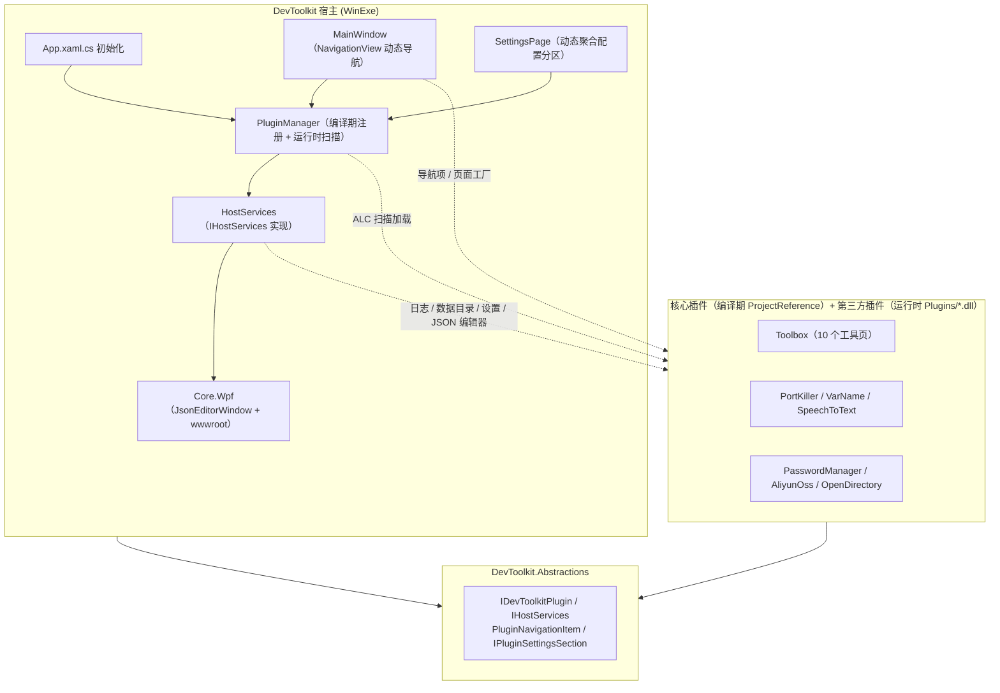

# FlowLauncher.Plugins

一套自用的 [Flow Launcher](https://github.com/Flow-Launcher/Flow.Launcher) 插件集合，同时包含一个 WPF 桌面宿主 **DevToolkit**——它把同一批功能以插件化方式组装成独立应用。

所有功能实现都放在 `src/Core/` 下的可复用模块中，Flow Launcher 插件与 DevToolkit 宿主共享这些模块，避免业务逻辑重复。

## 插件总览

| 关键字 | 插件 | 说明 |
|--------|------|------|
| `tool` | [Toolbox](src/FlowLauncher.Plugin.Toolbox/Readme.md) | 工具合集：GUID、JSON 编辑器、文件哈希、时间戳、编码转换、密码生成、进制转换、JWT、Cron |
| `kp` | [PortKiller](src/FlowLauncher.Plugin.PortKiller/Readme.md) | 查询端口占用进程并结束进程，带历史记录 |
| `vn` | [VarName](src/FlowLauncher.Plugin.VarName/Readme.md) | 中文翻译为变量名，生成 5 种命名规范，SQLite 缓存 |
| `pwd` | [PasswordManager](src/FlowLauncher.Plugin.PasswordManager/Readme.md) | 本地密码管理：SQLCipher 整库加密 + DPAPI 字段级加密 |
| `oss` | [AliyunOss](src/FlowLauncher.Plugin.AliyunOss/Readme.md) | 阿里云 OSS 文件上传 / 下载（`ossd` 下载、`ossu` 上传） |
| `dir` | [OpenDirectory](src/FlowLauncher.Plugin.OpenDirectory/Readme.md) | 解析文件 / 文件夹路径并打开所在目录 |
| `asr` | SpeechToText | 语音转文字，基于 ASR 模型实时识别并粘贴结果 |

## 环境要求

- Windows 10 / 11
- [.NET SDK 9.0](https://dotnet.microsoft.com/download)（全部项目目标框架为 `net9.0-windows7.0`）
- [Flow Launcher](https://github.com/Flow-Launcher/Flow.Launcher)（插件运行宿主）
- 构建 DevToolkit 宿主需要 Windows Desktop Runtime 9.0（`RollForward=LatestMajor`，装更高版本也可）

## 项目结构

```
FlowLauncher.Plugins/
├── src/
│   ├── FlowLauncher.Plugin.*/        # Flow Launcher 插件（7 个，含 plugin.json）
│   ├── DevToolkit/                   # WPF 插件化宿主（WinExe）
│   └── Core/                         # 可复用功能模块 + 契约层
│       ├── DevToolkit.Abstractions/  # 插件契约：IDevToolkitPlugin / IHostServices / Theme.xaml
│       ├── DevToolkit.Core.Wpf/      # 宿主共享能力：JsonEditorWindow + wwwroot（WebView2）
│       ├── DevToolkit.Toolbox/       # 工具箱业务 + 10 个工具页面
│       ├── DevToolkit.PortKiller/
│       ├── DevToolkit.VarName/
│       ├── DevToolkit.SpeechToText/
│       ├── DevToolkit.PasswordManager/
│       ├── DevToolkit.AliyunOss/
│       └── DevToolkit.OpenDirectory/
├── tests/                            # xUnit 单元测试（5 个项目）
├── scripts/                          # 构建 / 发布 / 联调脚本（PowerShell）
├── docs/                             # 开发计划与设计文档
├── Directory.Build.targets           # 发布目录版本后缀约定（对所有插件生效）
└── FlowLauncher.Plugins.slnx         # 解决方案
```

## 构建与测试

```powershell
# 还原 + 构建整个解决方案
dotnet build FlowLauncher.Plugins.slnx

# 构建单个插件
dotnet build src/FlowLauncher.Plugin.Toolbox/FlowLauncher.Plugin.Toolbox.csproj

# 运行全部单元测试
dotnet test FlowLauncher.Plugins.slnx

# 运行单个测试项目
dotnet test tests/Toolbox.UnitTest/Toolbox.UnitTest.csproj
```

单元测试基于 xUnit（`Microsoft.NET.Test.Sdk` + `xunit`），直接引用 `src/Core/` 下的业务模块：

| 测试项目 | 覆盖模块 |
|----------|----------|
| `tests/Toolbox.UnitTest` | 工具箱各纯函数服务（GUID、哈希、时间戳、编解码、进制、JWT、Cron） |
| `tests/VarName.UnitTest` | 命名规范转换与缓存 |
| `tests/PasswordManager.UnitTest` | 加密存储与查询 |
| `tests/AliyunOss.UnitTest` | OSS 配置与结果构建 |
| `tests/SpeechToText.UnitTest` | ASR 调用与文本处理 |

## 打包与发布

每个插件的发布由 `scripts/publish-<plugin>.ps1` 驱动，本质是一行：

```powershell
dotnet publish "$PSScriptRoot/../src/FlowLauncher.Plugin.Toolbox/FlowLauncher.Plugin.Toolbox.csproj" -p:PublishProfile=FolderProfile
```

发布目录命名由根目录 [`Directory.Build.targets`](Directory.Build.targets) 统一约定：

- 读取 `plugin.json` 中的 `Version`（**版本只需维护这一处**）；
- 在 `FolderProfile` 指定的 `PublishDir` 后拼接 `-<Version>`，例如 `...\Plugins\FlowLauncher.Plugin.Toolbox-1.0.0\`；
- 复制前清空目标目录，避免旧依赖 DLL 残留。

注意：`.pubxml` 发布配置按 `.gitignore` 约定**不入库**，需要在本地把 `FolderProfile` 的 `PublishDir` 指向 Flow Launcher 的 `Plugins` 目录。

Flow Launcher 运行时会锁定插件 DLL 导致发布失败，可先重启宿主：

```powershell
.\scripts\restart-flowlauncher.ps1                  # 重启
.\scripts\restart-flowlauncher.ps1 -Action Stop      # 仅停止
.\scripts\restart-flowlauncher.ps1 -Action Start     # 仅启动
```

### 脚本清单

| 脚本 | 用途 |
|------|------|
| `publish-<plugin>.ps1` | 发布指定插件（`varname` / `toolbox` / `portkiller` / `passwordmanager` / `aliyunoss` / `speechtotext` / `opendirectory`） |
| `restart-flowlauncher.ps1` | 停止 / 启动 Flow Launcher，解除插件 DLL 文件锁 |
| `generate-icons.ps1` | 基于文字（emoji）批量生成各插件的 `.ico` 图标 |
| `play-to-virtual-audio.ps1` | 把音频播放到 VB-Audio Virtual Cable 虚拟声卡，用于 ASR 联调 |
| `PlayAudio/` | 上述脚本使用的 NAudio 播放器控制台程序 |

## DevToolkit：插件化 WPF 宿主

DevToolkit 由单体应用重构为**插件宿主**：宿主只保留导航框架、日志、设置存储、数据目录与 WebView2 窗口等能力，所有功能均以插件形式提供。



核心契约：

```csharp
public interface IDevToolkitPlugin
{
    string Id { get; }
    string Name { get; }
    string Version { get; }
    void Initialize(IHostServices host);
    IReadOnlyList<PluginNavigationItem> GetNavigationItems();
    IReadOnlyList<IPluginSettingsSection> GetSettingsSections();
    event EventHandler? NavigationChanged;
}
```

- **编译期注册**：`BuiltInPlugins.Create()` 逐个实例化核心插件（`src/DevToolkit/Services/BuiltInPlugins.cs`）。
- **运行时扫描**：`PluginManager` 启动时通过 `AssemblyLoadContext` 扫描 `{BaseDir}\Plugins\*.dll` 加载第三方插件。
- **动态 UI**：左侧导航项、图标、页面工厂、设置分区全部由插件驱动，宿主不再硬编码。
- **容错**：单个插件初始化失败仅记日志并跳过，不阻断宿主启动；不实现热卸载，改动后重启宿主生效。

技术栈：.NET 9 + WPF、[iNKORE.UI.WPF.Modern](https://github.com/iNKORE-NET/UI.WPF.Modern)（Fluent 控件与导航）、CommunityToolkit.Mvvm、Serilog + Microsoft.Extensions.Logging、WebView2（JSON 编辑器）。

更多设计细节见 [`docs/DevToolkit_插件化宿主重构_17d76aa8.md`](docs/DevToolkit_插件化宿主重构_17d76aa8.md)。

## 关键第三方依赖

| 包 | 用途 |
|----|------|
| `Flow.Launcher.Plugin` 5.1.0 | Flow Launcher 插件 SDK |
| `CommunityToolkit.Mvvm` 8.4.0 | 插件设置面板 MVVM |
| `iNKORE.UI.WPF.Modern` 0.10.2.1 | Fluent 风格 UI 组件 |
| `Microsoft.Data.Sqlite` + `SQLitePCLRaw.bundle_e_sqlcipher` | VarName 缓存 / PasswordManager 加密库 |
| `AlibabaCloud.OSS.V2` | 阿里云 OSS SDK |
| `OpenAI` 2.8.0 | VarName 候选词生成 |
| `Microsoft.Windows.CsWin32` | PortKiller 进程信息 P/Invoke |
| `Cronos` | Cron 表达式解析 |

## 许可证

[MIT](LICENSE.txt)
